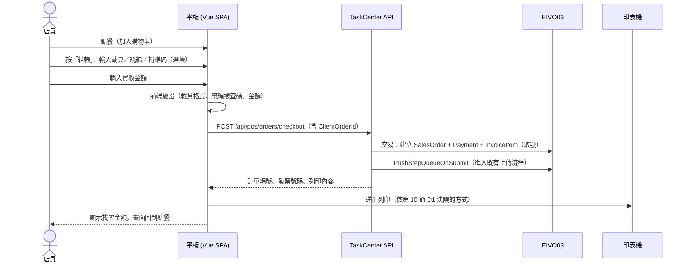
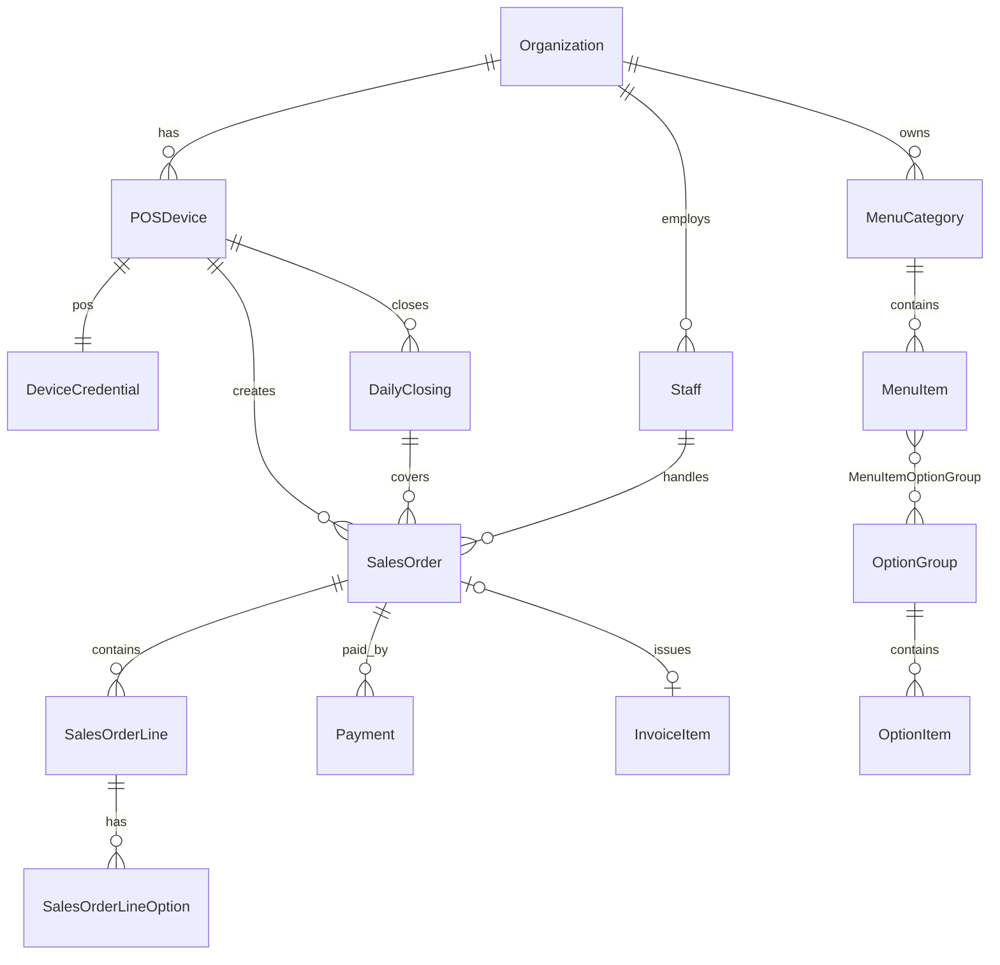

# POS 點餐結帳（Web 平板版）MVP 規格書

> **適用範圍**：TaskCenter（ASP.NET Core Web API + Vue 3 SPA）新增 POS 模組  
> **版本**：0.1 草案（2026-10-04）  
> **狀態**：待審閱，第 10 節「待決事項」確認後才進入開發

---

## 目錄

1. [目標與範圍](#1-目標與範圍)
2. [角色與使用情境](#2-角色與使用情境)
3. [系統架構](#3-系統架構)
4. [功能規格](#4-功能規格)
5. [電子發票規則](#5-電子發票規則)
6. [資料模型](#6-資料模型)
7. [API 規格](#7-api-規格)
8. [前端規格](#8-前端規格)
9. [非功能需求](#9-非功能需求)
10. [待決事項](#10-待決事項)
11. [既有程式重用對照](#11-既有程式重用對照)
12. [開發工作拆解與里程碑](#12-開發工作拆解與里程碑)
13. [驗收條件](#13-驗收條件)

---

## 1. 目標與範圍

### 1.1 目標

讓 EIVO 的 B2C 營業人（小型餐飲、零售門市）只要用一台平板加一台熱感印表機，就能完成「點餐 → 結帳 → 開立電子發票 → 列印證明聯」，不必另外購買 POS 系統。發票直接進入 EIVO 既有的開立與上傳流程。

### 1.2 MVP 範圍（In Scope）

| # | 功能 | 摘要 |
|---|------|------|
| F1 | 裝置配對與店員登入 | 平板綁定 POS 裝置，店員以 PIN 碼登入 |
| F2 | 菜單維護（後台） | 分類、商品、單層規格／加料選項、售完開關 |
| F3 | 前台點餐 | 分類瀏覽、商品格、選項、購物車、單品備註、內用／外帶 |
| F4 | 現金結帳 | 整單折扣、應收、實收、找零 |
| F5 | 開立 B2C 電子發票 | 結帳同時開立；支援手機條碼、自然人憑證、統編、捐贈碼 |
| F6 | 列印 | 電子發票證明聯、交易明細、補印 |
| F7 | 當期作廢 | 作廢訂單與發票，需店長授權 |
| F8 | 日結 | 當日營業彙總、現金清點、短溢記錄、列印日結單 |
| F9 | 訂單查詢 | 當日與歷史訂單查詢、檢視、補印 |

### 1.3 不在 MVP 範圍（Out of Scope）

留待第二期以後：掛單／取單、桌位圖、廚房出單／KDS、信用卡與行動支付串接、混合付款、拆帳、折讓退貨（G0401）、離線開立、會員、多門市報表、交班（MVP 只做日結）、庫存、時段價、多稅別混合（MVP 僅支援應稅 5%）。

> 第三期要做「離線開立」，但 MVP 的資料模型與 API 已預留 `ClientOrderId`（冪等鍵）和裝置號碼段，日後不需要改 schema。

---

## 2. 角色與使用情境

### 2.1 角色

| 角色 | 身分來源 | 權限 |
|------|---------|------|
| **營業人管理者** | 既有 EIVO 帳號（SELLER 角色），從 TaskCenter 後台登入 | 菜單維護、POS 裝置配對、店員維護、報表 |
| **店長（Manager）** | POS 店員（`pos.Staff`，Role = Manager） | 收銀全部功能，加上作廢授權、日結、補印證明聯 |
| **店員（Cashier）** | POS 店員（`pos.Staff`，Role = Cashier） | 點餐、結帳、補印交易明細、查詢當日訂單 |

> 店員**不需要** EIVO 帳號。POS 的權限由「裝置憑證＋店員 PIN」組成，避開現行 TaskCenter JWT 只帶 UID、沒有組織範圍的問題：裝置本身就綁定了營業人（`POSDevice.CompanyID`）。

### 2.2 主要情境：結帳開發票



### 2.3 次要情境

- **作廢**：查詢訂單 → 作廢 → 店長輸入 PIN → 選擇作廢原因 → 呼叫 `InvoiceManager.VoidInvoice` → 列印作廢單（選用）。
- **補印**：查詢訂單 → 補印。證明聯只能補印一次，而且要店長授權，並在列印內容加註「補印」。交易明細不限次數。
- **日結**：店長按「日結」→ 系統帶出當日彙總 → 輸入現金清點金額 → 計算短溢 → 送出並列印。日結後，當日的訂單不可再作廢。

---

## 3. 系統架構

### 3.1 放置位置

| 層 | 位置 | 說明 |
|----|------|------|
| 前台 UI | `TaskCenter/ClientApp/src/pos/` | 獨立路由 `/pos`，使用全螢幕 `PosLayout`，不套用 `DefaultLayout` 的側欄 |
| 後台 UI | `TaskCenter/ClientApp/src/components/Pos*Index.vue` | 菜單、裝置、店員維護，掛在既有選單下 |
| API | `TaskCenter/Core/Controllers/Pos*Controller.cs` | 繼承 `ApiBaseController`，路由前綴 `api/pos/...` |
| Service | `TaskCenter/Core/Services/Pos*Service.cs` | 透過 `IUnitOfWork` 存取資料 |
| DTO | `TaskCenter/Core/DTOs/Pos*Dto.cs` | 依專案慣例，逐屬性加 `[JsonPropertyName]` 輸出 camelCase |
| Entity | `ModelCore.EF/DataEntity/`（新增 `pos` schema 的實體） | Database-First：先建表再 scaffold |

### 3.2 認證模型

```
┌─────────────┐  1. 管理者在後台產生配對碼（6 位數，10 分鐘有效）
│ TaskCenter   │
│ 後台         │
└─────┬───────┘
      │
┌─────▼───────┐  2. 平板輸入配對碼 → POST /api/pos/device/pair
│ 平板         │     ← 取得 DeviceSecret（長效，存 localStorage）
│             │  3. 每次開機：POST /api/pos/device/session（DeviceSecret）
│             │     ← 取得 DeviceToken（JWT，12 小時）
│             │  4. 店員輸入 PIN：POST /api/pos/staff/login（DeviceToken + PIN）
│             │     ← 取得 PosToken（JWT，含 DeviceID / CompanyID / StaffID / StaffRole）
└─────────────┘
```

- `PosToken` 使用獨立的 JWT scheme `PosBearer`，跟既有後台的 JWT 分開：POS API 只接受 `PosBearer`，後台 API 不接受 `PosBearer`。
- 所有 POS API 的營業人範圍**一律**取自 token 的 `CompanyID` claim，前端不傳 sellerKey。
- 店長授權（作廢、補印證明聯）：請求內附 `managerPin`，伺服器端以同裝置所屬營業人的 Manager 驗證，並寫入稽核紀錄。
- PIN 連續錯誤 5 次，該店員鎖定 15 分鐘。
- 管理者可在後台「停用裝置」，停用後 DeviceSecret 立即失效。

> 舊版 `POSDeviceController` 使用的 Seed + Authorization（SHA256(統編 + Activation Key + Seed)）是給第三方 POS 廠商系統對接用的。Web POS 不使用這套機制，兩者並存。

---

## 4. 功能規格

### F1 裝置配對與店員登入

| 項目 | 規格 |
|------|------|
| 配對 | 後台「POS 裝置」頁對指定的 `POSDevice` 按「產生配對碼」；一個裝置同一時間只能有一台平板綁定，重新配對會讓舊憑證失效 |
| 店員維護 | 後台維護 `pos.Staff`：姓名、PIN（4–6 位數字）、角色、啟用狀態 |
| 登入畫面 | 數字鍵盤輸入 PIN；畫面顯示店名與裝置編號 |
| 自動登出 | 閒置 N 分鐘（預設 30，可設定）回到 PIN 畫面；購物車內容保留 |

### F2 菜單維護（後台）

| 項目 | 規格 |
|------|------|
| 分類 | 名稱、排序、啟用；每個營業人自有 |
| 商品 | 名稱、售價（含稅、整數元）、分類、圖片（選填）、排序、啟用、售完；可選擇連結 `scm.ProductCatalog`（帶入品名與條碼） |
| 選項群組 | 例如「甜度」「加料」：名稱、必選與否、最少／最多選幾項；選項：名稱、加價（可為 0） |
| 商品與選項 | 多對多：一個選項群組可以套用到多個商品 |
| 售完 | 前台和後台都可以切換，前台需要店長權限；售完的商品在前台顯示灰階、不能點選 |
| 版本 | 菜單異動時遞增 `MenuVersion`；前台每次結帳或每 60 秒比對一次，版本變了就重新載入 |

> MVP 只支援**單層**選項，不支援套餐（主餐 + 可選配餐）。

### F3 前台點餐

| 項目 | 規格 |
|------|------|
| 版面 | 橫式：左側分類＋商品格，右側購物車。直式：上方商品格，下方可展開的購物車抽屜 |
| 加入商品 | 點商品：沒有選項就直接加入；有選項就跳出選項面板，必選項沒選完不能確認 |
| 合併 | 同商品、同選項、同備註會合併數量 |
| 購物車操作 | 數量 +／−、左滑刪除、點品項可修改選項與備註、清空購物車（需確認） |
| 訂單類型 | 內用／外帶（必選，預設外帶）；內用可填桌號（自由文字，MVP 沒有桌位圖） |
| 金額 | 即時顯示小計、折扣、應收 |
| 取餐號 | 每日從 1 開始流水號，結帳時產生，印在交易明細上 |

### F4 現金結帳

| 項目 | 規格 |
|------|------|
| 整單折扣 | 金額折扣或百分比折扣（四捨五入到整數元）；折扣超過 N%（預設 20%）需要店長 PIN |
| 實收 | 數字鍵盤＋快捷金額（剛好、100、500、1000）；實收小於應收時不能送出 |
| 找零 | 實收 − 應收，結帳成功後用大字顯示 |
| 防重複送出 | 前端在進入結帳畫面時產生 `ClientOrderId`（UUID），送出期間按鈕鎖定；網路逾時重送沿用同一個 ID，伺服器回傳第一次的結果 |
| 失敗處理 | 開立發票失敗時整筆交易回滾（訂單不成立），回傳錯誤訊息，購物車保留 |
| 付款方式 | MVP 只有 `Cash`；`pos.Payment` 預留 `Method` 欄位供第二期擴充 |

### F5 開立 B2C 電子發票

詳見[第 5 節](#5-電子發票規則)。結帳畫面上的「發票資訊」區塊有四個互斥頁籤：

| 頁籤 | 輸入方式 |
|------|---------|
| 紙本（預設） | 不需輸入 |
| 載具 | 手機條碼（可用相機掃描，或手動輸入 `/` 加 7 碼）、自然人憑證 |
| 統編 | 8 位數字，選填抬頭；前端即時驗證檢查碼 |
| 捐贈 | 捐贈碼，或從營業人預設的常用愛心碼按鈕中選擇 |

### F6 列印

| 單據 | 何時列印 | 內容 |
|------|---------|------|
| 電子發票證明聯 | 結帳時，PrintMark = Y | 依財政部 5.7cm 格式：店名、「電子發票證明聯」、期別、發票號碼、日期時間、隨機碼、總計、賣方統編、買方統編（B2B）、一維條碼、左右 QR Code |
| 交易明細 | 每次結帳都印（可設定只在有載具或捐贈時才印） | 品項、選項、數量、單價、小計、折扣、應收、實收、找零、取餐號、訂單類型、桌號、店員 |
| 日結單 | 日結送出時 | 見 F8 |
| 作廢單（選用） | 作廢時 | 原發票號碼、作廢時間、原因、授權店長 |

- **列印內容由伺服器產生**：QR Code 左碼裡的加密資料要用營業人 AES 金鑰（`BuildEncryptedData`），金鑰不可以下發到前端。
- 伺服器回傳結構化的列印資料（見 7.4 節），再依第 10 節 D1 決議的列印方式輸出。
- 列印失敗不影響交易成立：前端顯示「列印失敗，請補印」，訂單會標記為「未列印」。

### F7 當期作廢

| 項目 | 規格 |
|------|------|
| 可作廢條件 | 發票期別等於當期、該營業日還沒日結、訂單狀態為 Completed |
| 授權 | 店長 PIN（店長本人操作時也要再輸入一次） |
| 原因 | 下拉選單：顧客取消、輸入錯誤、重複結帳、其他（必填說明） |
| 處理 | 交易中：`InvoiceManager.VoidInvoice` 產生作廢（F0501 流程），訂單狀態改為 Voided，寫入 `pos.AuditLog` |
| 重開 | MVP 不提供「作廢後以原號重開」，作廢後請重新點餐結帳 |
| 現金 | 作廢訂單的金額從日結的應有現金中扣除 |

### F8 日結

| 項目 | 規格 |
|------|------|
| 營業日 | 以 `pos.DailyClosing` 為界：從上次日結之後到這次日結之間的訂單（可以跨過午夜） |
| 彙總內容 | 訂單筆數、營業額（已完成訂單）、作廢筆數與金額、折扣總額、發票張數（紙本／載具／捐贈／統編）、發票起訖號碼、應有現金 |
| 清點 | 輸入開店準備金與清點的現金，系統計算短溢；短溢不為 0 時必填說明 |
| 送出 | 只有店長可以操作；送出後該營業日鎖定 |
| 跨裝置 | MVP 日結**以裝置為單位**（一台平板一個錢櫃） |

### F9 訂單查詢

- 前台：當日訂單清單（可依取餐號、發票號碼、金額搜尋），可以檢視明細、補印、作廢。
- 後台：歷史訂單查詢（日期區間、裝置、店員、狀態），可匯出 Excel（ClosedXML，同步產出）。

---

## 5. 電子發票規則

### 5.1 開立

| 規則 | 說明 |
|------|------|
| 開立管線 | 沿用 `CreateInvoiceService.CommitAsync` 的路徑：`InvoiceViewModelValidator` 產生 `InvoiceItem` → `Add` → `PushStepQueueOnSubmit` → `SubmitChanges`，讓發票進入既有的 F0401 上傳流程 |
| 取號 | 伺服器端在開立的交易中取號（`TrackNoManager`）。如果裝置有專屬號碼段（`POSInvoiceNoSegment`），就優先使用 → 見 D3 |
| 開立時間 | 以伺服器時間為準 |
| 隨機碼 | 4 位數，由伺服器產生 |
| 稅別 | MVP 固定應稅、稅率 5%，商品售價一律含稅 |
| B2C 金額 | 買方為一般消費者：`SalesAmount = 含稅總額`、`TaxAmount = 0`、`TotalAmount = 含稅總額` |
| B2B 金額（有統編） | `SalesAmount = Round(Total / 1.05)`、`TaxAmount = Total − SalesAmount`；明細單價以含稅價記錄，並在備註標示「單價含稅」（依現行 `InvoiceViewModelValidator` 對 B2B 的處理方式；如有衝突以 validator 為準） |
| 折扣 | 整單折扣寫成一筆負數明細「折扣」，讓明細合計等於發票總額 |
| 明細品名 | `商品名稱(選項1/選項2)`；超過欄位長度時截斷，完整內容保留在訂單 |
| 關聯 | `pos.SalesOrder.InvoiceID → InvoiceItem.InvoiceID`；`InvoiceItem.RelateNumber`（或 DataNumber）寫入訂單編號，方便從發票反查 |

### 5.2 前端驗證規則（伺服器端以 validator 再驗一次）

| 欄位 | 規則 |
|------|------|
| 手機條碼 | `^\/[0-9A-Z.+\-]{7}$`（共 8 碼，`/` 開頭） |
| 自然人憑證 | `^[A-Z]{2}[0-9]{14}$` |
| 捐贈碼 | `^[0-9]{3,7}$` |
| 統編 | 8 位數字，用加權（1,2,1,2,1,2,4,1）檢查碼驗證；合計可被 **5** 整除即通過（2023 年後的新制，兼容舊制的 10）；第 7 碼為 7 時另外處理 |
| 互斥 | 統編 ⟂ 捐贈；載具 ⟂ 捐贈；MVP 不支援統編加載具併用 |

> 載具類別代碼（如手機條碼 `3J0002`、自然人憑證 `CQ0001`）要跟 `InvoiceViewModelValidator` 現行使用的常數對齊，開發時先確認。

### 5.3 PrintMark 與證明聯

| 情境 | PrintMark | 證明聯 | 交易明細 |
|------|-----------|-------|---------|
| 一般消費者、無載具 | Y | 列印 | 列印 |
| 載具 | N | 不印 | 列印 |
| 捐贈 | N | 不印 | 列印 |
| 統編 | Y | 列印（含買方統編、格式 25） | 列印 |

### 5.4 證明聯內容組成（伺服器產生）

| 元素 | 內容 |
|------|------|
| 期別 | 例如 `115年09-10月` |
| 一維條碼（Code39） | 民國年 3 碼 + 期別迄月 2 碼 + 字軌號碼 10 碼 + 隨機碼 4 碼（共 19 碼） |
| 左 QR | 沿用 `InvoiceItem.GetQRCodeContent()`（WebHome/Helper/ExtensionMethods.cs）：號碼 + 日期 + 隨機碼 + 銷售額／總額（hex）+ 買賣方統編 + 加密資料 + 明細 |
| 右 QR | `**` 開頭的明細延續內容（左碼放不下的部分） |

> 現行 WebHome 的 `C0401_POS.cshtml` 和 `PrintC0401POS.cshtml` 已經有 57mm 的 HTML 版型，可以作為版面參考。QR 和條碼產生的邏輯要從 WebHome/Helper 抽到共用專案（ModelExtension.EF），讓 TaskCenter 可以呼叫。

### 5.5 上傳

發票由既有流程（DocumentFlow → Turnkey）上傳。POS 模組不另外處理上傳，但後台訂單查詢要顯示發票的上傳狀態，方便追蹤 48 小時時限。

---

## 6. 資料模型

### 6.1 既有資料表（沿用）

| 表 | 用途 |
|----|------|
| `dbo.Organization` | 營業人（店家）= `CompanyID` |
| `dbo.POSDevice` | POS 裝置（`DeviceID`、`POSNo`、`CompanyID`） |
| `dbo.POSInvoiceNoSegment` / `InvoiceNoSegment` | 裝置專屬號碼段（D3） |
| `dbo.InvoiceItem` 及其子表 | 發票（`InvoiceBuyer`、`InvoiceCarrier`、`InvoiceDonation`、`InvoiceProduct`…） |
| `dbo.InvoiceCancellation` | 作廢 |
| `scm.ProductCatalog` / `scm.ProductSupplier` | 商品主檔（選擇性連結） |

### 6.2 新增資料表（schema：`pos`）



| 表 | 主要欄位 | 備註 |
|----|---------|------|
| `pos.DeviceCredential` | `DeviceID` PK/FK, `SecretHash`, `PairingCode`, `PairingExpiry`, `Status`（Active/Disabled）, `PairedAt`, `LastSeenAt`, `Settings` (nvarchar(max) JSON：印表機、閒置時間、常用愛心碼…) | 不修改既有的 `POSDevice` 表 |
| `pos.Staff` | `StaffID` PK, `CompanyID` FK, `Name`, `PinHash`, `Role`（1=Cashier, 2=Manager）, `IsActive`, `FailedCount`, `LockedUntil` | PIN 使用 PBKDF2 雜湊；登入時先選店員再驗 PIN，所以 PIN 不需要唯一 |
| `pos.MenuCategory` | `CategoryID` PK, `CompanyID` FK, `Name`, `SortOrder`, `IsActive` | |
| `pos.MenuItem` | `ItemID` PK, `CompanyID` FK, `CategoryID` FK, `ProductID` FK NULL → `scm.ProductCatalog`, `Name`, `Price` decimal(18,0), `ImageUrl`, `SortOrder`, `IsActive`, `IsSoldOut` | |
| `pos.OptionGroup` | `GroupID` PK, `CompanyID` FK, `Name`, `IsRequired`, `MinSelect`, `MaxSelect`, `SortOrder` | |
| `pos.OptionItem` | `OptionID` PK, `GroupID` FK, `Name`, `PriceDelta` decimal(18,0), `SortOrder`, `IsActive` | |
| `pos.MenuItemOptionGroup` | (`ItemID`, `GroupID`) PK, `SortOrder` | |
| `pos.MenuVersion` | `CompanyID` PK, `Version` int, `UpdatedAt` | 菜單異動時遞增 |
| `pos.SalesOrder` | `OrderID` PK bigint, `CompanyID`, `DeviceID`, `StaffID`, `ClientOrderId` uniqueidentifier, `OrderNo` nvarchar(20)（如 `{POSNo}-{yyMMdd}-{seq}`）, `PickupNo` int, `OrderType`（1=內用, 2=外帶）, `TableNo`, `Subtotal`, `DiscountAmount`, `TotalAmount`, `Status`（1=Completed, 9=Voided）, `InvoiceID` FK NULL, `PrintStatus`, `ClosingID` FK NULL, `CreatedAt`, `VoidedAt`, `VoidReason`, `VoidByStaffID` | 唯一索引：(`DeviceID`, `ClientOrderId`) 作為冪等鍵；索引：(`CompanyID`, `CreatedAt`) |
| `pos.SalesOrderLine` | `LineID` PK, `OrderID` FK, `ItemID`, `ItemName`（快照）, `UnitPrice`（含選項）, `Quantity`, `Amount`, `Note`, `SortOrder` | 名稱與價格存快照，避免菜單異動影響歷史訂單 |
| `pos.SalesOrderLineOption` | `LineID` FK, `OptionID`, `GroupName`, `OptionName`, `PriceDelta` | 快照 |
| `pos.Payment` | `PaymentID` PK, `OrderID` FK, `Method`（1=Cash）, `Amount`, `Tendered`, `Change`, `CreatedAt` | |
| `pos.DailyClosing` | `ClosingID` PK, `DeviceID`, `StaffID`, `PeriodStart`, `PeriodEnd`, `OrderCount`, `SalesAmount`, `VoidCount`, `VoidAmount`, `DiscountAmount`, `OpeningCash`, `ExpectedCash`, `CountedCash`, `Variance`, `VarianceNote`, `InvoiceSummary` (JSON) | |
| `pos.DailySequence` | (`DeviceID`, `BusinessDate`) PK, `PickupSeq`, `OrderSeq` | 用 `UPDATE ... OUTPUT` 原子遞增 |
| `pos.AuditLog` | `LogID` PK, `CompanyID`, `DeviceID`, `StaffID`, `AuthorizedByStaffID`, `Action`（Void/Reprint/Discount/SoldOut/Login…）, `TargetOrderID`, `Detail` (JSON), `CreatedAt` | |

> DDL 腳本放在 `docs/DB/pos.*.Table.sql`，命名沿用現有慣例；建表後再 scaffold 到 ModelCore.EF。

---

## 7. API 規格

- 回應格式統一使用 `ApiBaseController` 的 `ResponseDto<T>`（`CreateSuccessResponse` / `CreateErrorResponse`）。
- DTO 逐屬性加 `[JsonPropertyName]`，輸出 camelCase。
- 前端的 POS API client 另外寫在 `src/pos/services/pos-api.ts`，使用 `PosToken`，不共用後台的 `api-service.ts` token。

### 7.1 認證與裝置（`PosAuthController`）

| Method | Path | Auth | 說明 |
|--------|------|------|------|
| POST | `/api/pos/device/pair` | 匿名 | `{ pairingCode }` → `{ deviceId, posNo, storeName, deviceSecret }` |
| POST | `/api/pos/device/session` | 匿名 | `{ deviceId, deviceSecret }` → `{ deviceToken, expiresAt, settings }` |
| GET | `/api/pos/staff` | DeviceToken | 店員清單（只回傳姓名與 ID，供登入畫面選擇） |
| POST | `/api/pos/staff/login` | DeviceToken | `{ staffId, pin }` → `{ posToken, staff: { id, name, role }, expiresAt }` |
| POST | `/api/pos/staff/logout` | PosToken | |

### 7.2 菜單（`PosMenuController`）

| Method | Path | Auth | 說明 |
|--------|------|------|------|
| GET | `/api/pos/menu` | PosToken | 完整菜單（分類 → 商品 → 選項群組 → 選項）＋ `version` |
| GET | `/api/pos/menu/version` | PosToken | `{ version }`，供輪詢比對 |
| PUT | `/api/pos/menu/items/{itemId}/soldout` | PosToken（Manager） | `{ isSoldOut }` |

### 7.3 訂單與結帳（`PosOrderController`）

| Method | Path | Auth | 說明 |
|--------|------|------|------|
| POST | `/api/pos/orders/checkout` | PosToken | 結帳加開立發票（見下方範例） |
| GET | `/api/pos/orders` | PosToken | 當前營業日訂單；`?keyword=`（取餐號／發票號碼） |
| GET | `/api/pos/orders/{orderId}` | PosToken | 訂單明細 |
| POST | `/api/pos/orders/{orderId}/void` | PosToken | `{ reason, note, managerStaffId, managerPin }` |
| GET | `/api/pos/orders/{orderId}/print?type=receipt\|detail` | PosToken | 取得列印資料；`receipt` 補印需 `managerPin`（POST 版本） |
| POST | `/api/pos/orders/{orderId}/printed` | PosToken | 回報列印結果，更新 `PrintStatus` |

**`POST /api/pos/orders/checkout` 請求**

```json
{
  "clientOrderId": "6b1f3c1e-8f53-4a43-9a4e-2f8f0b5f7d21",
  "menuVersion": 42,
  "orderType": 2,
  "tableNo": null,
  "lines": [
    { "itemId": 101, "quantity": 2, "optionIds": [5, 12], "note": "去冰" },
    { "itemId": 205, "quantity": 1, "optionIds": [], "note": null }
  ],
  "discount": { "type": "amount", "value": 10, "managerStaffId": null, "managerPin": null },
  "expectedTotal": 180,
  "payment": { "method": 1, "tendered": 200 },
  "invoice": {
    "mode": "carrier",
    "carrierType": "3J0002",
    "carrierId": "/ABC+123",
    "buyerReceiptNo": null,
    "buyerName": null,
    "npoban": null
  }
}
```

- `invoice.mode`：`paper` | `carrier` | `taxId` | `donate`
- **伺服器重新計價**：以資料庫中的現行價格計算，跟 `expectedTotal` 不一致時回傳 409 `PRICE_CHANGED`，並附上最新菜單版本，前端重新整理購物車。
- 商品售完或已停用：409 `ITEM_UNAVAILABLE`（附上 itemId 清單）。

**回應**

```json
{
  "orderId": 900123,
  "orderNo": "P01-261004-0057",
  "pickupNo": 57,
  "totalAmount": 180,
  "change": 20,
  "invoice": {
    "invoiceNo": "AB12345678",
    "randomNo": "1234",
    "printMark": "Y"
  },
  "print": { "...": "見 7.4" },
  "replayed": false
}
```

- 同一個 `clientOrderId` 重送：回傳原本的結果，`replayed: true`，HTTP 200。

**錯誤碼**

| HTTP | code | 說明 |
|------|------|------|
| 400 | `VALIDATION_FAILED` | 欄位驗證失敗（`errors` 依欄位列出） |
| 401 | `TOKEN_EXPIRED` | 前端回到 PIN 畫面 |
| 403 | `MANAGER_REQUIRED` / `MANAGER_PIN_INVALID` | |
| 409 | `PRICE_CHANGED` / `ITEM_UNAVAILABLE` / `DAY_CLOSED` | |
| 422 | `NO_INVOICE_NUMBER` | 沒有可用的字軌號碼，需要提示管理者配號 |
| 422 | `INVOICE_REJECTED` | validator 拒絕（附上訊息） |

### 7.4 列印資料格式

伺服器回傳**與印表機無關**的列印指令陣列，由前端或列印代理轉成 ESC/POS（或 ePOS XML）：

```json
{
  "paperWidth": 58,
  "documents": [
    {
      "type": "receipt",
      "copies": 1,
      "elements": [
        { "t": "text", "v": "XX 小吃店", "align": "center", "size": 2, "bold": true },
        { "t": "text", "v": "電子發票證明聯", "align": "center", "size": 2 },
        { "t": "text", "v": "115年09-10月", "align": "center", "size": 2, "bold": true },
        { "t": "text", "v": "AB-12345678", "align": "center", "size": 2, "bold": true },
        { "t": "text", "v": "2026-10-04 12:30:45" },
        { "t": "cols", "v": ["隨機碼 1234", "總計 180"] },
        { "t": "cols", "v": ["賣方 12345678", ""] },
        { "t": "barcode", "format": "CODE39", "v": "11510AB123456781234" },
        { "t": "qrpair", "left": "AB12345678...", "right": "**..." },
        { "t": "cut" }
      ]
    },
    { "type": "detail", "copies": 1, "elements": [ "..." ] }
  ]
}
```

> 如果 D1 決議採用 HTML 列印（`window.print`），伺服器改回傳 57mm HTML，由前端放進 iframe 列印；`elements` 格式保留給其他列印方式使用。

### 7.5 日結（`PosClosingController`）

| Method | Path | Auth | 說明 |
|--------|------|------|------|
| GET | `/api/pos/closing/preview` | PosToken（Manager） | 當前營業日彙總 |
| POST | `/api/pos/closing` | PosToken（Manager） | `{ openingCash, countedCash, varianceNote }` → 日結結果＋列印資料 |
| GET | `/api/pos/closing/history` | PosToken（Manager） | 近 30 筆 |

### 7.6 後台管理（使用既有後台 JWT，SELLER／SYS 角色，以 `CanAccessSeller` 守門）

| 控制器 | 主要端點 |
|--------|---------|
| `PosMenuAdminController` | 分類／商品／選項群組／選項 CRUD、排序、圖片上傳（multipart） |
| `PosDeviceAdminController` | 裝置清單（擴充現有 POSDevice 管理）、產生配對碼、停用、裝置設定 |
| `PosStaffAdminController` | 店員 CRUD、重設 PIN、解鎖 |
| `PosOrderAdminController` | 歷史訂單查詢、明細、Excel 匯出、日結紀錄 |

營業人範圍：參照現有 `sellerKey`（EncryptKey 加密的 CompanyID）的做法。

---

## 8. 前端規格

### 8.1 目錄結構

```
ClientApp/src/pos/
├── PosApp.vue                 ← /pos 根元件（PosLayout，全螢幕）
├── router.ts                  ← /pos/pair, /pos/login, /pos/order, /pos/orders, /pos/closing
├── services/
│   ├── pos-api.ts             ← axios instance（PosToken、401 攔截 → login）
│   └── printer/
│       ├── index.ts           ← PrintAdapter 介面
│       └── <D1 決議的實作>.ts
├── composables/
│   ├── usePosSession.ts       ← 裝置／店員 session、閒置登出
│   ├── usePosMenu.ts          ← 菜單載入、版本輪詢
│   ├── usePosCart.ts          ← 購物車（模組層級 reactive 單例）
│   ├── useCheckout.ts         ← 結帳流程、ClientOrderId、重送
│   └── useInvoiceInput.ts     ← 載具／統編／捐贈驗證
├── components/
│   ├── PinPad.vue  NumPad.vue
│   ├── CategoryTabs.vue  ProductGrid.vue  OptionSheet.vue
│   ├── CartPanel.vue  CartLine.vue
│   ├── CheckoutDialog.vue  InvoiceInfoTabs.vue  BarcodeScanner.vue
│   ├── ChangeDisplay.vue  ManagerAuthDialog.vue
│   └── OrderList.vue  OrderDetail.vue  ClosingForm.vue
└── utils/
    └── validators.ts          ← 統編檢查碼、載具 regex（附單元測試）
```

- 跟後台 SPA 共用同一個 Vite 專案和建置，但 `/pos` 路由使用獨立 layout，不載入後台選單。
- 狀態管理：沿用專案現有的 composable 模式（不引入 Pinia）。
- TypeScript：新檔一律用 `.ts` / `<script setup lang="ts">`，並通過 `npm run typecheck`。
- 部署在子路徑時遵循 `document.baseURI` 的做法（見既有子路徑部署設定）。

### 8.2 觸控與版面準則

| 項目 | 準則 |
|------|------|
| 目標裝置 | 10–11 吋平板；iPadOS 16+ Safari、Android 10+ Chrome |
| 解析度 | 橫式 ≥ 1024×768 為主，直式 768×1024 可用 |
| 點擊目標 | ≥ 48×48 px；商品格 ≥ 120×100 px |
| 字級 | 內文 ≥ 16px；金額 ≥ 24px；找零 ≥ 48px |
| 手勢 | 關閉雙指縮放（`touch-action: manipulation`）、下拉重新整理（`overscroll-behavior: none`）、長按選字 |
| 全螢幕 | 提供 Web App Manifest（`display: standalone`、`orientation: any`），可以加到主畫面 |
| 回饋 | 加入購物車時有短暫動畫；送出中顯示全畫面遮罩，避免重複點擊 |
| 離線 | 偵測 `navigator.onLine` 加 API 失敗，顯示紅色橫幅「離線中：無法結帳」，結帳按鈕停用 |

### 8.3 畫面清單

| 畫面 | 路由 | 重點 |
|------|------|------|
| 配對 | `/pos/pair` | 輸入 6 位配對碼；成功後顯示店名與裝置編號 |
| 店員登入 | `/pos/login` | 選擇店員 → PIN 鍵盤 |
| 點餐（主畫面） | `/pos/order` | 分類、商品格、購物車；頂列顯示店員、裝置、連線狀態、選單（訂單、日結、登出） |
| 結帳對話框 | （overlay） | 應收金額、折扣、發票資訊頁籤、實收鍵盤、找零 |
| 結帳完成 | （overlay） | 大字顯示找零、取餐號；列印狀態；3 秒後或點擊返回 |
| 訂單查詢 | `/pos/orders` | 清單、搜尋、明細、補印、作廢 |
| 日結 | `/pos/closing` | 彙總、清點輸入、送出、列印 |

---

## 9. 非功能需求

| 類別 | 需求 |
|------|------|
| 效能 | 菜單載入 < 1 秒（200 個商品以內）；結帳 API P95 < 2 秒（含開立發票） |
| 並行 | 取號沿用 `TrackNoManager` 的 `LockID` 機制；同一營業人多台裝置同時結帳不可重號（要有並行測試） |
| 一致性 | 訂單、付款、發票在同一個 DB 交易；任一步失敗就全部回滾 |
| 冪等 | (`DeviceID`, `ClientOrderId`) 唯一；重送回傳原結果 |
| 安全 | 全站 HTTPS；PIN／DeviceSecret 只存雜湊；POS API 只能存取 token 中的 `CompanyID`；作廢、補印、大額折扣、售完切換都寫入 `pos.AuditLog` |
| 日誌 | 結帳失敗時記錄 request（遮罩載具號碼）與例外，寫入既有 Logger |
| 相容 | 不修改既有 `POSDevice` 欄位；舊的 `/POSDevice/*`（第三方 POS 對接）維持原樣 |
| 稽核保存 | 訂單資料保存至少 5 年（依商業會計法） |

---

## 10. 待決事項

| # | 議題 | 選項 | 建議 |
|---|------|------|------|
| **D1** | **列印方式** | A. **伺服器轉送＋店內列印代理**：平板 → API → 列印佇列 → 店內代理程式（長輪詢或 WebSocket 主動連出）→ ESC/POS。B. **印表機原生 HTTPS API**（Epson ePOS-Print／Star WebPRNT）：平板直接呼叫區網印表機。C. **瀏覽器列印**（`window.print` 輸出 57mm HTML，透過 AirPrint／Android 列印服務） | **A 為主、C 為備援**。理由：B 的頁面是 HTTPS，呼叫區網 HTTP 印表機會被混合內容（mixed content）擋下，印表機要另外設定自簽憑證並讓平板信任，現場部署困難；A 的代理主動連出，不受混合內容限制，也可以延伸既有 InvoiceClient 的 `POSPrintWatcher` 模式。C 的速度和版面控制較差，但不需要額外硬體，適合試營運 |
| D2 | 統編加載具併用 | 支援／不支援 | MVP 不支援，第二期依需求評估 |
| D3 | 取號來源 | A. 營業人共用區間（同線上開立）。B. 裝置專屬號碼段（`POSInvoiceNoSegment`） | MVP 用 **A**（不需要額外配號作業）；B 留給第三期離線開立。要先確認 `TrackNoManager(…, deviceNo)` 目前的行為 |
| D4 | 交易明細是否每單都印 | 每單印／只在無證明聯時印 | 做成裝置設定，預設每單都印 |
| D5 | 日結單位 | 以裝置／以營業人 | MVP 以裝置 |
| D6 | 店員身分 | A. 獨立 `pos.Staff` + PIN。B. 沿用 EIVO `UserProfile` | **A**：店員流動率高，不適合發 EIVO 帳號 |
| D7 | 菜單圖片儲存 | 檔案系統／DB／物件儲存 | 依現有附件（Attachment）儲存方式 |
| D8 | 計費 | POS 是否另外計費、是否影響現有 BillingGrade | 待業務確認 |

---

## 11. 既有程式重用對照

| 需求 | 既有程式 | 處理方式 |
|------|---------|---------|
| 發票驗證與建立 | `InvoiceViewModelValidator`（ModelExtension.EF） | 直接重用 |
| 開立管線 | `CreateInvoiceService.CommitAsync`（TaskCenter） | 抽出共用的 `IssueB2CInvoice(...)`，供 POS 與線上開立共用 |
| 取號 | `TrackNoManager`（ModelExtension.EF） | 重用 |
| 作廢 | `InvoiceManager.VoidInvoice`、`InvoiceProcessActionService` | 重用 |
| QR 內容 | `InvoiceItem.GetQRCodeContent()`、`BuildEncryptedData()`（WebHome/Helper/ExtensionMethods.cs） | **搬到 ModelExtension.EF**，讓 WebHome 與 TaskCenter 共用 |
| 57mm 版型 | `WebHome/Views/DataView/C0401_POS.cshtml`、`PrintC0401POS.cshtml` | 作為版面參考（D1 選 C 時可以直接改寫成 TaskCenter 版本） |
| 裝置主檔 | `POSDevice`、`POSDeviceDto`、`POSDeviceDialog.vue` | 後台裝置頁擴充「配對碼」「停用」 |
| 列印代理 | `InvoiceClient/Agent/POSHelper/POSPrintWatcher.cs` | D1 選 A 時參考或延伸 |
| 第三方 POS 預配號（第三期離線用） | `POSDeviceController.AllocateInvoiceNo` / `CommitInvoice`、`InvoiceNoAllocation`（含 `RandomNo`、`EncryptedContent`） | MVP 不使用；離線開立時沿用這組預配號協定 |
| 角色範圍 | `CanAccessSeller`、`sellerKey`（EncryptKey） | 後台 API 沿用 |
| 背景處理 | `InvoiceProcessBackgroundService`（Channel 佇列） | D1 選 A 時，列印佇列可採相同模式 |

---

## 12. 開發工作拆解與里程碑

| 里程碑 | 工作項目 | 預估 |
|--------|---------|------|
| **M0 決議** | 確認第 10 節待決事項；採購並測試 1 款熱感印表機 | 0.5 週 |
| **M1 基礎** | `pos` schema DDL 與 scaffold；`PosBearer` 認證；裝置配對、店員 PIN 登入；後台裝置與店員維護 | 1.5 週 |
| **M2 菜單** | 後台菜單 CRUD（分類、商品、選項）；`GET /api/pos/menu`；前台商品格、選項面板、購物車 | 2 週 |
| **M3 結帳開票** | 抽出共用開立管線、QR 共用化；checkout API（計價、冪等、交易）；結帳 UI、發票資訊驗證、條碼掃描 | 2 週 |
| **M4 列印** | 列印資料產生器（receipt／detail）；D1 選定方式的 PrintAdapter；（A 方案）列印代理 | 1.5 週 |
| **M5 作廢與日結** | 作廢 API 與 UI、店長授權、AuditLog；日結 API、UI、列印；前台訂單查詢 | 1.5 週 |
| **M6 後台與驗收** | 歷史訂單查詢與 Excel 匯出；並行取號測試；現場試營運（1 家店、1 週） | 1.5 週 |
| | **合計** | **約 10.5 週（1 位全端工程師）** |

---

## 13. 驗收條件

### 13.1 功能

- [ ] 新平板輸入配對碼後可以綁定裝置；後台停用裝置後，該平板下一次呼叫 API 就回 401。
- [ ] 店員 PIN 錯誤 5 次會鎖定 15 分鐘。
- [ ] 菜單異動後，前台在 60 秒內或下一次結帳時更新；用舊價格結帳會收到 `PRICE_CHANGED`。
- [ ] 有必選選項的商品，沒選完不能加入購物車。
- [ ] 現金結帳後，發票寫入 `InvoiceItem`，金額、明細、載具／捐贈／統編正確，並進入既有上傳流程。
- [ ] 用同一個 `clientOrderId` 重送 3 次，只產生 1 張訂單和 1 張發票。
- [ ] 證明聯格式符合財政部規範，QR Code 可被財政部「統一發票兌獎」App 正確解析。
- [ ] 有載具或捐贈時不印證明聯；有統編時，證明聯上印出買方統編。
- [ ] 作廢需要店長 PIN；作廢後發票狀態為已作廢，日結金額同步扣除。
- [ ] 日結後，該營業日的訂單不能再作廢。
- [ ] 證明聯補印需要店長授權，並加註「補印」；只能補印一次。

### 13.2 異常

- [ ] 斷網時結帳按鈕停用；恢復連線後自動解除。
- [ ] 結帳 API 逾時後重送，不會重複開立。
- [ ] 字軌號碼用完時回傳 `NO_INVOICE_NUMBER`，前端提示「請聯絡管理者配號」，購物車保留。
- [ ] 印表機離線時交易仍然成立，訂單標記為「未列印」，之後可以補印。

### 13.3 並行與效能

- [ ] 同一營業人 5 台裝置各連續結帳 100 筆（共 500 筆），發票號碼不重複、不跳號（作廢除外）。
- [ ] 結帳 API P95 < 2 秒。

### 13.4 前端

- [ ] iPad（Safari）與 Android 平板（Chrome）的橫式與直式都可以完整操作。
- [ ] `npm run typecheck` 通過；`validators.ts` 單元測試涵蓋統編新舊制與第 7 碼為 7 的案例。
